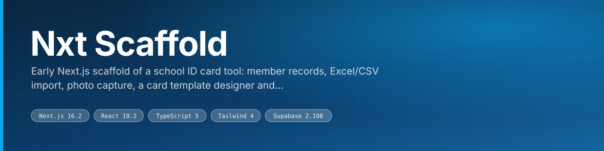
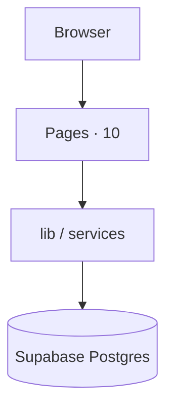

<div align="center">



Early Next.js scaffold of a school ID card tool: member records, Excel/CSV import, photo capture, a card template designer and QR/barcode verify pages.

<br>

[](https://nextjs.org) [](https://react.dev) [](https://www.typescriptlang.org) [](https://tailwindcss.com) [](https://supabase.com)

 

</div>

---

## What this is

A web application for schools to manage student/staff records and design, generate, and
print **ID cards** (CR80 PVC + digital QR IDs).

## Stack
- **Next.js 16** (App Router) + **React 19** + **TypeScript**
- **Tailwind CSS v4** + **shadcn/ui**
- **Supabase** — Postgres, Auth, Storage, Row-Level Security
- **Rendering** — HTML/CSS templates → print-ready PDF; QR (`qrcode`) + barcode (`bwip-js`)
- **Data import** — Excel/CSV via SheetJS (`xlsx`)
- **Testing** — Playwright · **Deploy** — Vercel

## Prerequisites
- Node ≥ 20 (this machine: v24 via nvm), **pnpm**
- A Supabase project (cloud or local)

## Setup
```bash
pnpm install
cp .env.example .env.local        # then fill in your Supabase keys
## Apply the database schema:
## • via Supabase Studio SQL editor, or
## • supabase db push, or
## • the Supabase MCP `apply_migration` using supabase/migrations/0001_init.sql
pnpm dev                          # http://localhost:3000
```

### First-run bootstrap
1. Sign up the first user in the app (a profile row is auto-created as `operator`).
2. Promote them and create the school — see the bootstrap SQL at the bottom of
   `supabase/migrations/0001_init.sql`.

## Project structure
```
src/
  app/                 # App Router routes (login, dashboard, verify, api)
  lib/
    supabase/          # client.ts · server.ts · middleware.ts · admin.ts
    types.ts           # domain types mirroring the DB schema
    constants.ts       # CR80 card dimensions, roles, bindable fields
    utils.ts           # cn() class merge
  middleware.ts        # session refresh + route guard
supabase/migrations/   # SQL schema + RLS (0001_init.sql)
inventory/             # this machine's tooling manifest (see INVENTORY.md, STACK.md)
```

## Scripts
| Command | Purpose |
|---------|---------|
| `pnpm dev` | Start the dev server |
| `pnpm build` | Production build |
| `pnpm start` | Run the production build |
| `pnpm lint` | ESLint |

## Roadmap
Phased build tracked in `inventory/STACK.md`: Phase 0 scaffold → 1 records & photos →
2 template designer → 3 batch render/print & digital ID → 4 roles/audit → 5 test/harden/deploy.

## Security notes
- `.env.local` is git-ignored; only `.env.example` is committed.
- `SUPABASE_SERVICE_ROLE_KEY` is **server-only** — never imported client-side (`src/lib/supabase/admin.ts`).
- Student data is PII — RLS scopes every row to the user's school; review before production.

---

## Architecture



<sub>Derived from the directories present in this repository.</sub>

---

## Surfaces

**Routes** (10)

|  |  |  |
|---|---|---|
| `/` | `/dashboard` | `/login` |
| `/members` | `/members/[id]/edit` | `/members/import` |
| `/members/new` | `/templates` | `/templates/[id]/edit` |
| `/verify/[token]` |  |  |

---

## Stack

| Layer | Choice |
|---|---|
| [Next.js](https://nextjs.org) | v16.2 |
| [React](https://react.dev) | v19.2 |
| [TypeScript](https://www.typescriptlang.org) | v5 |
| [Tailwind](https://tailwindcss.com) | v4 |
| [Supabase](https://supabase.com) | v2.108 |

---

## Getting started

```bash
git clone https://github.com/gowtham-creator/Nxt-Schools-ID-Card-.git
cd Nxt-Schools-ID-Card-
pnpm install
pnpm run dev
```

### Scripts

| Command | Runs |
|---|---|
| `pnpm run dev` | `next dev` |
| `pnpm run start` | `next start` |
| `pnpm run build` | `next build` |
| `pnpm run lint` | `eslint` |

Configuration comes from the environment. Copy the checked-in template and fill in your own values:

```bash
cp .env.example .env.local
```

---

## Project structure

| Path | Contents | Files |
|---|---|---|
| `src/app/` | application routes | 23 |
| `src/lib/` | shared library code | 11 |
| `inventory/` | — | 7 |
| `public/` | static assets | 5 |
| `docs/` | documentation | 1 |
| `src/` | — | 1 |
| `supabase/` | Supabase config and migrations | 1 |

<sub>246 tracked files in total.</sub>

---

<div align="center">
<sub><a href="https://github.com/gowtham-creator/Nxt-Schools-ID-Card-">gowtham-creator/Nxt-Schools-ID-Card-</a></sub>
</div>
